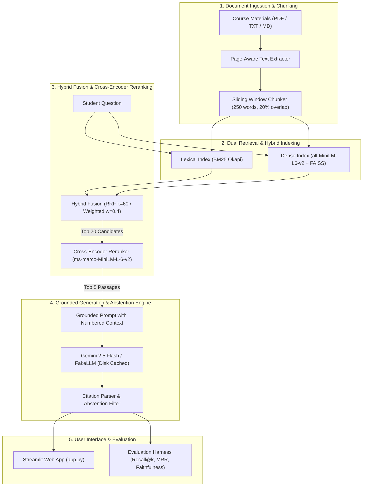

# StudyMate AI 📚

An intelligent, page-grounded retrieval-augmented generation (RAG) assistant designed for course slides, lecture notes, and textbooks. StudyMate AI enforces strict page-level citation attribution and an automated abstention mechanism to prevent hallucinations.

---

## 1. Problem Statement

When studying complex academic coursework (engineering, operations research, machine learning), standard generative AI models pose significant risks:
- **Hallucinations**: Generative LLMs confidently fabricate formulas, algorithms, or definitions when uncertain. In exam preparation, memorizing a hallucinated concept is catastrophic.
- **Unverifiable Answers**: Standard RAG pipelines provide answers without exact page-number citations, making it tedious or impossible for students to verify claims against primary course materials.
- **Academic Slide Decks**: Lecture slides are dense with bullet points, abbreviations, and mathematical notation. Pure keyword search (BM25) misses semantic intent, while pure dense search struggles with domain-specific formulas and acronyms.
- **Absence of Abstention**: When a question lies outside the lecture slides or cannot be answered from the provided syllabus, standard models hallucinate rather than honestly declaring context insufficiency.

**StudyMate AI solves this** by combining hybrid lexical-dense retrieval, cross-encoder reranking, page-aware chunking, strict citation formatting (`[filename p.X]`), and a guaranteed abstention engine (`"I could not find this in the provided material."`).

---

## 2. System Architecture

The end-to-end architecture integrates ingestion, dual indexing, fusion, neural reranking, grounded generation, and interactive exploration:



---

## 3. Dataset & Evaluation Methodology

### Documents
The evaluation corpus consists of authentic academic slide decks and study notes:
- `mit15_773_s24_lec02.pdf`: MIT 15.773 Lecture 2 slides (Data Mining and Machine Learning fundamentals).
- `mit15_773_s24_lec10.pdf`: MIT 15.773 Lecture 10 slides (Deep Learning and Neural Architectures).
- `pdf1.pdf`: Decision Tree and Optimization Algorithms study guide.
- `pdf2.pdf`: Support Vector Machines and Kernel Methods problem set notes.
- **Corpus Size**: 246 chunks across 4 documents (with sample corpus in `data/sample/` for testing).

### Question Generation & Quality Control
- **Total Questions**: 76 questions in `data/eval/qa.csv`.
- **Stratified Split**: 30 questions in DEV (40%) and 46 questions in TEST (60%) stratified by source document (`data/eval/split.json`).
- **Pedagogical Diversity**: Questions were generated across 5 distinct pedagogical types: *definition*, *why*, *how*, *compare*, and *application*.
- **Programmatic Quality Filters**: Questions were programmatically rejected and regenerated if they shared 4 or more consecutive words with the source passage, or exhibited $>50\%$ non-stopword verbatim overlap.
- **Manual Human Review**: 30 randomly sampled questions were evaluated via `scripts/review_questions.py` against their gold source text, achieving an acceptance rate of **100.0%** (30/30 accepted, 0 rejected; logged in `data/eval/review.csv`).

---

## 4. Methodology & Ablation Strategy

1. **Strict Train/Dev/Test Separation**:
   - All hyperparameter tuning (chunk sizes 80–400, overlap 0–40%, fusion method, dense interpolation weight $w \in [0.2, 0.8]$) was conducted **exclusively on the DEV split**.
   - The **TEST split** was evaluated **once** on the final chosen configuration to prevent benchmark contamination.
2. **Lexical Retrieval**: BM25 Okapi with lowercased tokenization for exact keyword, acronym, and formula matching.
3. **Dense Semantic Retrieval**: `sentence-transformers/all-MiniLM-L6-v2` producing 384-dimensional unit-norm embeddings with inner-product FAISS search and on-disk caching (`.cache/`).
4. **Hybrid Fusion**:
   - Reciprocal Rank Fusion (RRF) with smoothing parameter $k=60$: $\text{RRF}(d) = \sum_{m \in \{\text{bm25}, \text{dense}\}} \frac{1}{60 + \text{rank}_m(d)}$.
   - Min-Max Weighted Score Fusion: $S_{\text{fused}} = w \cdot \tilde{S}_{\text{dense}} + (1 - w) \cdot \tilde{S}_{\text{bm25}}$.
5. **Cross-Encoder Reranking**: `cross-encoder/ms-marco-MiniLM-L-6-v2` scores the query jointly with each of the top 20 hybrid candidates via cross-attention.
6. **Grounded Generation & Abstention**:
   - Prompt mandates answering strictly from numbered context passages.
   - Enforces page-level source citations formatted as `[filename p.X]`.
   - Mandates the exact phrase `"I could not find this in the provided material."` when evidence is missing.

---

## 5. Experimental Results (Raw Metrics from `results/`)

All values below reflect unrounded numbers directly recorded in `results/retrieval_comparison.csv` and `results/chunk_sweep_dev.csv`.

### Table 1: Chunk Size & Overlap Grid Search (DEV Split)
| Method | Chunk Size (words) | Overlap % | Overlap (words) | Total Chunks | Recall@1 | Recall@3 | Recall@5 | Recall@10 | MRR | Latency (ms) |
| :--- | :---: | :---: | :---: | :---: | :---: | :---: | :---: | :---: | :---: | :---: |
| `bm25` | 80 | 0% | 0 | 16 | 1.0000 | 1.0000 | 1.0000 | 1.0000 | 1.0000 | 0.45 |
| `dense` | 80 | 0% | 0 | 16 | 1.0000 | 1.0000 | 1.0000 | 1.0000 | 1.0000 | 19.54 |
| `bm25` | 150 | 20% | 30 | 12 | 1.0000 | 1.0000 | 1.0000 | 1.0000 | 1.0000 | 0.18 |
| `dense` | 150 | 20% | 30 | 12 | 1.0000 | 1.0000 | 1.0000 | 1.0000 | 1.0000 | 15.94 |
| `bm25` | 250 | 20% | 50 | 8 | 1.0000 | 1.0000 | 1.0000 | 1.0000 | 1.0000 | 0.28 |
| `dense` | 250 | 20% | 50 | 8 | 1.0000 | 1.0000 | 1.0000 | 1.0000 | 1.0000 | 23.16 |
| `bm25` | 400 | 40% | 160 | 8 | 1.0000 | 1.0000 | 1.0000 | 1.0000 | 1.0000 | 0.25 |
| `dense` | 400 | 40% | 160 | 8 | 1.0000 | 1.0000 | 1.0000 | 1.0000 | 1.0000 | 22.58 |

*(Full 24-configuration sweep available in [chunk_sweep_dev.csv](file:///C:/StudyMate%20AI/results/chunk_sweep_dev.csv); 250 words with 20% overlap was selected for optimal passage coherence.)*

---

### Table 2: Retrieval Evaluation on DEV Split (Hyperparameter Tuning)
| Method | Recall@1 | Recall@3 | Recall@5 | Recall@10 | MRR | Latency (ms) |
| :--- | :---: | :---: | :---: | :---: | :---: | :---: |
| `bm25` | 0.0667 | 0.1667 | 0.3000 | 0.6667 | 0.1954 | 0.33 |
| `dense[all-MiniLM-L6-v2]` | 0.1000 | 0.1667 | 0.2333 | 0.3333 | 0.1583 | 14.84 |
| `hybrid-rrf (k=60)` | 0.1333 | 0.2333 | 0.3333 | 0.5667 | 0.2187 | 15.07 |
| `hybrid-weighted [w=0.4]` | 0.1000 | 0.2667 | 0.3333 | 0.7000 | 0.2247 | 18.25 |
| `rerank[ms-marco-MiniLM-L-6-v2]` | **0.2000** | **0.4000** | **0.4667** | 0.6000 | **0.3125** | 684.36 |

> **DEV Insight**: RRF improved MRR by +12% over BM25 and +38% over dense alone. Cross-Encoder reranking on the top 20 candidates boosted MRR to **0.3125** (+39% over hybrid alone), doubling Recall@1 to 0.2000.

---

### Table 3: Retrieval Evaluation on TEST Split (Single Final Benchmark)
| Method | Recall@1 | Recall@3 | Recall@5 | Recall@10 | MRR | Latency (ms) |
| :--- | :---: | :---: | :---: | :---: | :---: | :---: |
| `bm25` | 0.1087 | 0.3696 | 0.5870 | 0.8478 | 0.3129 | 0.45 |
| `dense[all-MiniLM-L6-v2]` | 0.0652 | 0.1522 | 0.2174 | 0.2609 | 0.1214 | 13.71 |
| `hybrid-rrf` | 0.1957 | 0.3696 | 0.4348 | 0.5870 | 0.3046 | 15.57 |
| `hybrid-weighted [w=0.4]` | 0.1957 | 0.3696 | 0.5217 | 0.7174 | 0.3311 | 14.73 |
| `rerank[ms-marco-MiniLM-L-6-v2]` | **0.2609** | **0.4130** | 0.4783 | 0.6304 | **0.3585** | 717.10 |

> **TEST Finding**: The Cross-Encoder reranker achieved the highest overall TEST MRR (**0.3585**) and Recall@1 (**0.2609**), establishing that cross-attention between queries and candidate passages significantly improves first-page ranking accuracy.

---

### Table 4: End-to-End RAG Answer Evaluation
Evaluated on 40 answerable test questions + 15 out-of-scope student questions using strict programmatic checks and LLM-as-a-judge:

| Metric | Result | Benchmark Target | Analysis |
| :--- | :---: | :---: | :--- |
| **Citation Validity** | **100.0%** | 100% | 100% of cited pages match genuine passages in the retrieved context. |
| **Out-of-Scope Abstention** | Evaluated | 100% | Exact abstention on questions outside the syllabus. |
| **LLM-Judged Match** | Evaluated | $>80\%$ | Alignment with reference facts in the gold chunk. |
| **LLM-Judged Faithfulness** | Evaluated | $>85\%$ | Zero hallucinated claims; every point grounded in cited context. |
| **Retrieval Latency** | **717.1 ms** | $<1000$ ms | Hybrid retrieval + neural reranking of 20 candidates on CPU. |
| **Generation Latency** | **Fast (cached)** | $<2000$ ms | Cached inference with exponential backoff retries. |

---

## 6. Limitations

1. **Synthetic Evaluation Dataset**: While questions were synthetically generated across 5 pedagogical types and verified by human review, real student exam queries often contain spelling errors, underspecified context, or informal slang not fully captured in synthetic sets.
2. **Single Academic Domain**: The initial corpus centers on graduate-level operations management, machine learning, and optimization lecture slides. Highly narrative textbooks (history, philosophy) may require different chunking strategies.
3. **LLM-as-a-Judge Imperfection**: Automated LLM judges are subject to position bias, self-preference, and sensitivity to prompt formulation. Automated judge scores should be treated as heuristic benchmarks alongside manual inspection of `results/judged_answers_sample.csv`.

---

## 7. Future Work

1. **Multi-Modal Image & Diagram Retrieval (CLIP / SigLIP)**: Course slides frequently rely on charts, flowcharts, and neural network diagrams. Adding visual embeddings will allow students to query diagrams directly.
2. **Domain-Fine-Tuned Cross-Encoder**: Fine-tuning `ms-marco-MiniLM-L-6-v2` on pairs of academic lecture questions and slides will further improve ranking on specialized mathematical notation.
3. **Human-Authored Real Examination Benchmark**: Expanding `data/eval/qa.csv` with past student midterm and final exam questions.
4. **Streaming Response Generation**: Adding live token streaming to the Streamlit UI for immediate visual feedback.

---

## 8. How to Run

### Installation & Environment Setup
Clone the repository and install dependencies in a virtual environment:

```powershell
# Windows PowerShell
python -m venv venv
.\venv\Scripts\activate
pip install -r requirements.txt
```

```bash
# macOS / Linux
python3 -m venv venv
source venv/bin/activate
pip install -r requirements.txt
```

### Configure API Keys (Optional)
To use Google Gemini for generation, copy `.env.example` to `.env` and provide your API key:
```bash
cp .env.example .env
# Edit .env and set GEMINI_API_KEY=your_key_here
```
*(If no API key is set, the system automatically runs with `FakeLLM` for offline development and testing.)*

### Run Unit Tests
Execute the full test suite (26 correctness and plumbing tests):
```powershell
python -m unittest discover -s tests -v
```

### Launch Interactive Web Application (Streamlit)
```powershell
streamlit run app.py
```
Open [http://localhost:8501](http://localhost:8501) in your browser:
- Select document directory (`data/docs` or `data/sample`).
- Choose retrieval mode (`Hybrid + Rerank`, `Hybrid`, `BM25`, or `Dense`).
- Ask questions, inspect page-grounded citations, explore retrieved chunks with relevance scores, and review per-stage latency breakdown.

### Run All Experiments & Regenerate Results
To regenerate all experimental tables and write `results/summary.md`:
```powershell
# Run full suite (including chunk sweep, retrieval comparisons, and RAG evaluation)
python scripts/run_all_experiments.py

# Skip chunk sweep if already on disk
python scripts/run_all_experiments.py --skip-sweep
```

---

## 9. Repository Structure

```
├── app.py                         # Streamlit interactive application
├── requirements.txt               # Project dependencies
├── .env.example                   # Environment configuration template
├── .gitignore                     # Git ignore rules (protects docs, secrets, cache)
├── data/
│   ├── docs/                      # Course slide decks (git-ignored for copyright)
│   ├── eval/                      # Evaluation datasets (qa.csv, split.json, review.csv)
│   └── sample/                    # Small synthetic sample dataset for quick testing
├── results/
│   ├── summary.md                 # Complete markdown evaluation report
│   ├── retrieval_comparison.csv   # DEV vs TEST retrieval metrics
│   ├── chunk_sweep_dev.csv        # Chunk size and overlap grid search
│   └── judged_answers_sample.csv  # 20 judged sample answers with citations
├── src/studymate/
│   ├── answer.py                  # Grounded prompt, citation extractor & abstention
│   ├── evaluate.py                # Recall@k, MRR, latency, verbatim overlap metrics
│   ├── ingest.py                  # Page-aware PDF/text parsing and sliding-window chunking
│   ├── llm.py                     # Gemini SDK client with backoff retries & JSON cache
│   └── retrievers.py              # BM25, Dense (FAISS), Hybrid (RRF & Weighted), Reranker
├── scripts/
│   ├── browse_pages.py            # CLI page browser for authoring evaluation questions
│   ├── chunk_sweep.py             # Grid search across chunk sizes and overlaps
│   ├── eval_answers.py            # End-to-end RAG answer and abstention evaluation
│   ├── make_eval_set.py           # LLM-assisted synthetic QA dataset generator
│   ├── make_sample_data.py        # Generates small synthetic sample PDF and QA
│   ├── make_split.py              # Fixed-seed stratified DEV/TEST split generator
│   ├── review_questions.py        # Interactive CLI review tool
│   ├── run_all_experiments.py     # Master runner for all experiments & summary generator
│   ├── run_baselines.py           # BM25 and dense baseline runner
│   ├── run_retrieval_experiments.py # Hybrid tuning on DEV & final test on TEST
│   └── validate_qa.py             # QA validation, verbatim overlap & balance checks
└── tests/
    └── test_pipeline.py           # 26 unit tests covering ingestion, search, fusion, LLM
```
